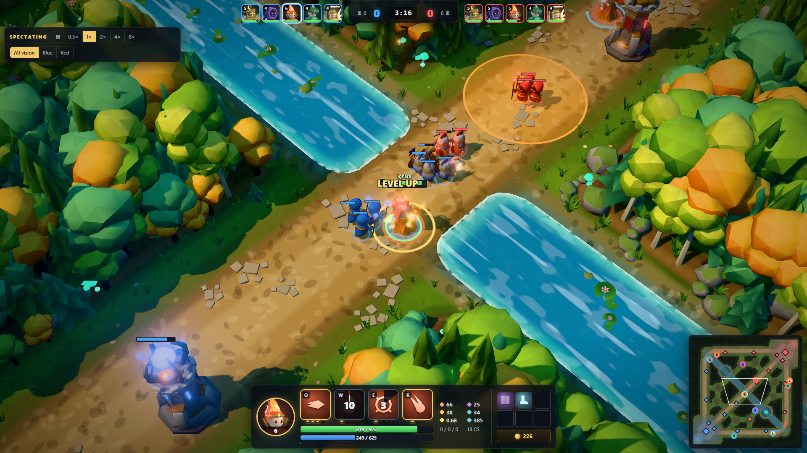

# AIMOBA League

Build a bot for AIMOBA, a 5v5 MOBA, and enter it in the league: a daily tournament in which every entry plays
every other one, with standings, Elo ratings and a replay of every game.

A bot is one program that plays all five heroes of a team. It can be a few rules in JavaScript or Python, a
trained neural network, or any program that speaks a small JSON protocol. This repository has everything to
write one, play it, watch it and enter it. The game runs on your machine, so you can play thousands of test
games before you enter one.



## Start

You need [Node.js](https://nodejs.org) 22.18 or newer. Python is only needed for Python bots and for training.

```
git clone https://github.com/jbettaque/aimoba-league aimoba
cd aimoba
npm install

./aimoba init my-bot                  # a working rule-based bot in bots/my-bot
./aimoba play my-bot easy --watch     # play a game against the easy bots and watch it
./aimoba bench my-bot easy -n 40      # win rate over 40 games
```

On Windows the command is `.\aimoba`.

The league takes bots from public GitHub repositories, so start your own from this one: **Use this template**
on GitHub, make the new repository public, and clone that instead of this one. Your bots live in `bots/`, which
is meant to be committed.

Then open `bots/my-bot/bot.js`: the whole bot is one function that runs five times a second. When it does what
you want, commit and push it, and enter it:

```
./aimoba validate my-bot              # the league's checks, run here
./aimoba login --server https://aimoba.joleif.dev
./aimoba submit my-bot                # enters the commit you have checked out
```

## Guides

- [Get started](docs/league/README.md): the same steps with more explanation
- [What a bot sees and can do](docs/league/api.md): every field of the game state, every order, the helpers
- [Entering a trained model](docs/league/ml.md): the observation and action of the ML interface, training, entering a network
- [Other languages](docs/league/protocol.md): the protocol, for a bot in anything else
- [Rules and ranking](docs/league/rules.md): thinking time, the sandbox, the tournament, the ratings

## Four ways to build a bot

| `./aimoba init my-bot --kit ...` | What you get |
| --- | --- |
| `js` (the default) | Rules in JavaScript. Fastest to iterate on: 40 test games take a few seconds with `--fast`. |
| `python` | The same rules in Python. |
| `policy` | A trained network and no code. The league runs it for you. |
| `python-model` | A Python agent that runs a network with numpy. Start here for your own architecture. |

The kits are starting points, not contenders: the rule-based ones lose most games to the built-in `easy` bots.

## The command

```
./aimoba init <name> [--kit js|python|python-model|policy]   start a bot in bots/<name>
./aimoba play <blue> <red> [--watch] [--seed N] [--fast]     one game; saves a replay
./aimoba bench <bot> <opponent> [-n 20] [--fast]             many games from both sides, with a win rate
./aimoba tournament <bot> <bot> ...                          a local tournament with standings and ratings
./aimoba watch <replay.json>                                 open a replay in the game client
./aimoba validate <bot directory>                            the league's checks, run here
./aimoba export <checkpoint.pt> <bot directory>              put a trained network into an entry
./aimoba info [--json]                                       rules, heroes and the data a bot receives
./aimoba login | submit | status | logs                      the league
```

An opponent is `easy`, `basic` or `expert` (the game's scripted bots), `policy:selfplay` (a trained network that
ships with the game), or another bot of yours.

## Training a model

`python/aimoba` is a vectorised reinforcement-learning environment over the same simulation, and `python/train`
holds trainers for it (imitation of the expert bot, PPO, self-play) with an exporter for the league. See
[Entering a trained model](docs/league/ml.md).

## Playing the game yourself

```
npm run dev
```

opens the game at http://localhost:5173: play a hero with the bots, or watch them play each other.

## What is here

```
bots/           your bots (created by ./aimoba init)
kits/           the starter bots that init copies
docs/league/    the guides
src/sim/        the game: a deterministic simulation, the same code the league runs
src/agent/      the bot interface: what a bot sees, its orders, the protocol, the match runner
src/client/     the game client, for playing and for watching replays
python/         aimoba_agent.py (the Python bot SDK), the training environment and the trainers
docker/         the images entries run in on the league, to test with --docker
```

## Keeping up to date

The league plays on its own copy of the game. When the game changes, this repository is updated, and
`./aimoba submit` tells you if your copy is behind. Then:

```
git pull
```

or, in a repository you started from the template:

```
git remote add template https://github.com/jbettaque/aimoba-league      # once
git pull template main --allow-unrelated-histories
```

Your bots live in `bots/`, which updates never touch.

This repository is generated from the game's main repository (`TEMPLATE_VERSION` says from which commit).
Reports of problems are welcome here; changes to the game itself are made there.

## Licence

[MIT](LICENSE).
